# Student Register

A full-stack application for managing student records: add, view, update and delete students, with search, filtering, sorting and pagination.

The interface is built around a registrar's workflow and a documented design system ([docs/DESIGN_SYSTEM.md](docs/DESIGN_SYSTEM.md)). Each student's details open as a student ID card.

## Screenshots

### Student list

| Desktop (1440px) | Tablet (768px) | Mobile (390px) |
|---|---|---|
| 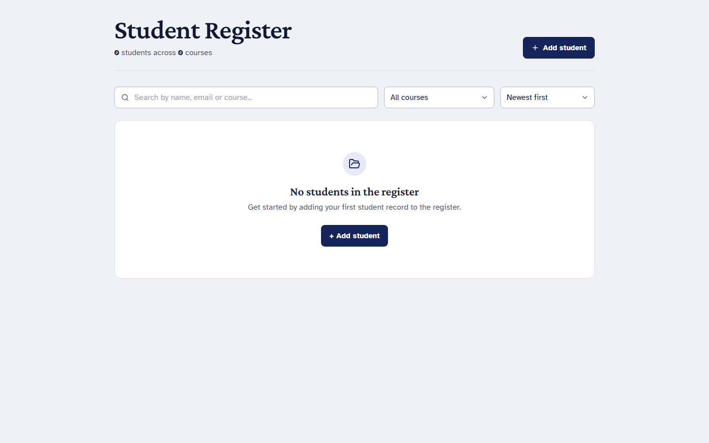 | 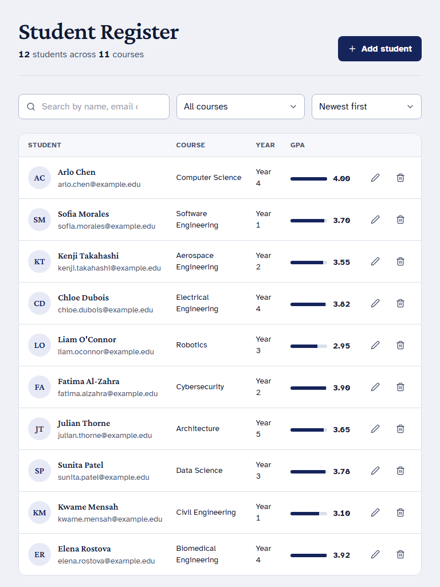 | 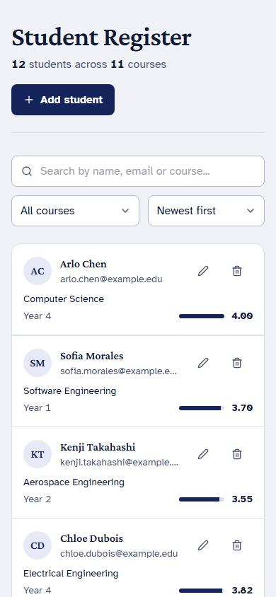 |

### Add / edit drawer

| Desktop (1440px) | Tablet (768px) | Mobile (390px) |
|---|---|---|
| 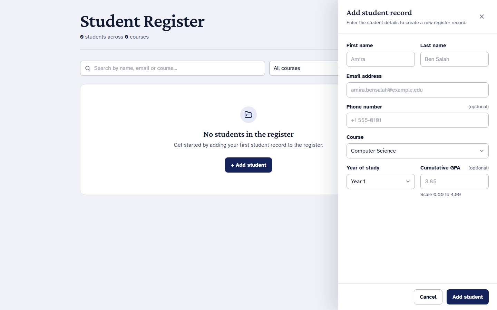 | 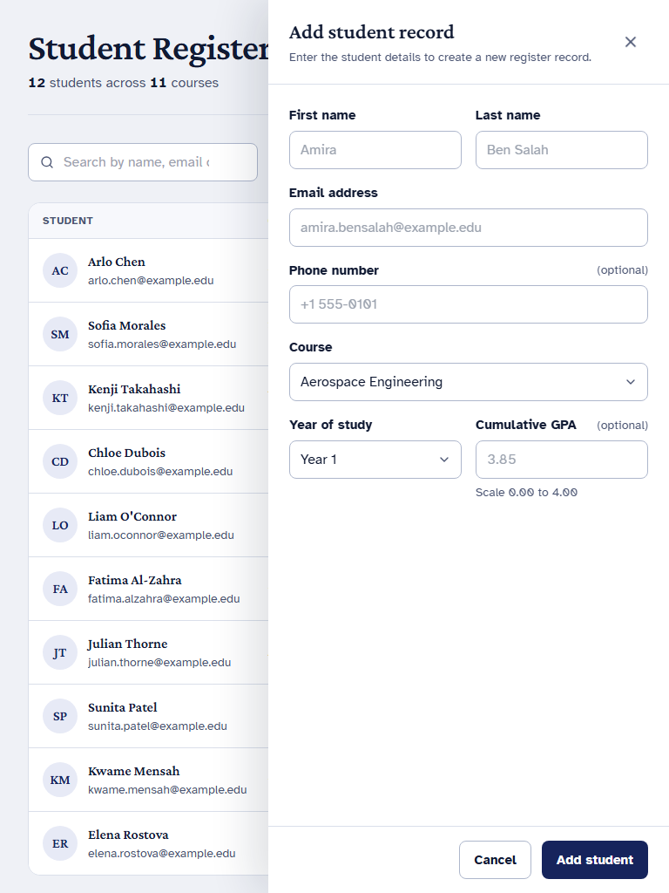 | 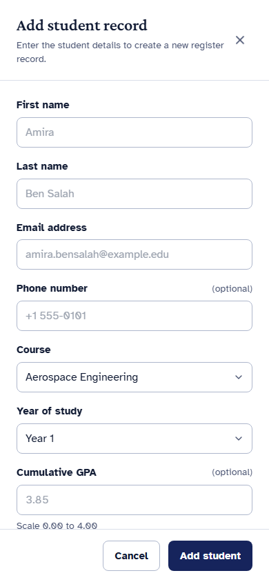 |

### Student ID card

| Desktop (1440px) | Tablet (768px) | Mobile (390px) |
|---|---|---|
| 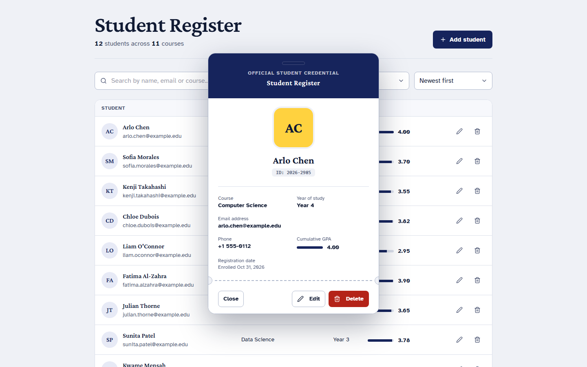 | 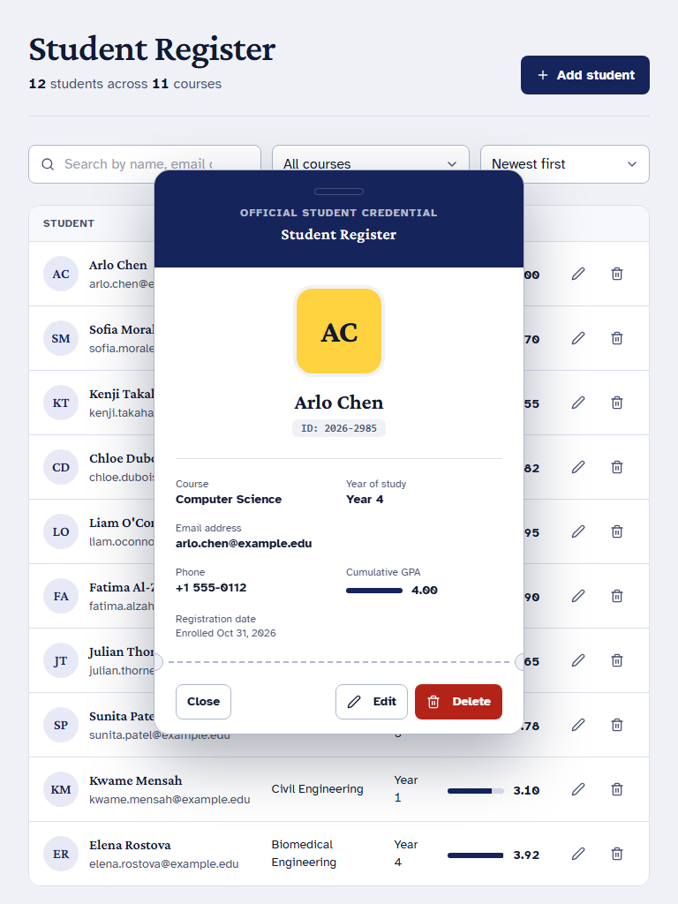 | 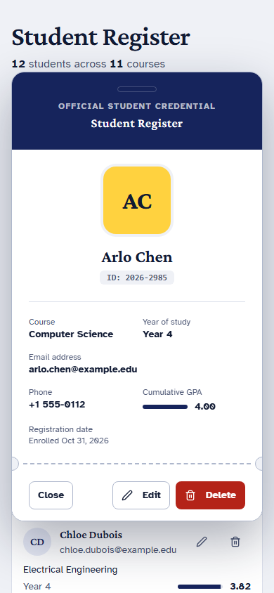 |

### Delete confirmation

| Desktop (1440px) | Tablet (768px) | Mobile (390px) |
|---|---|---|
| 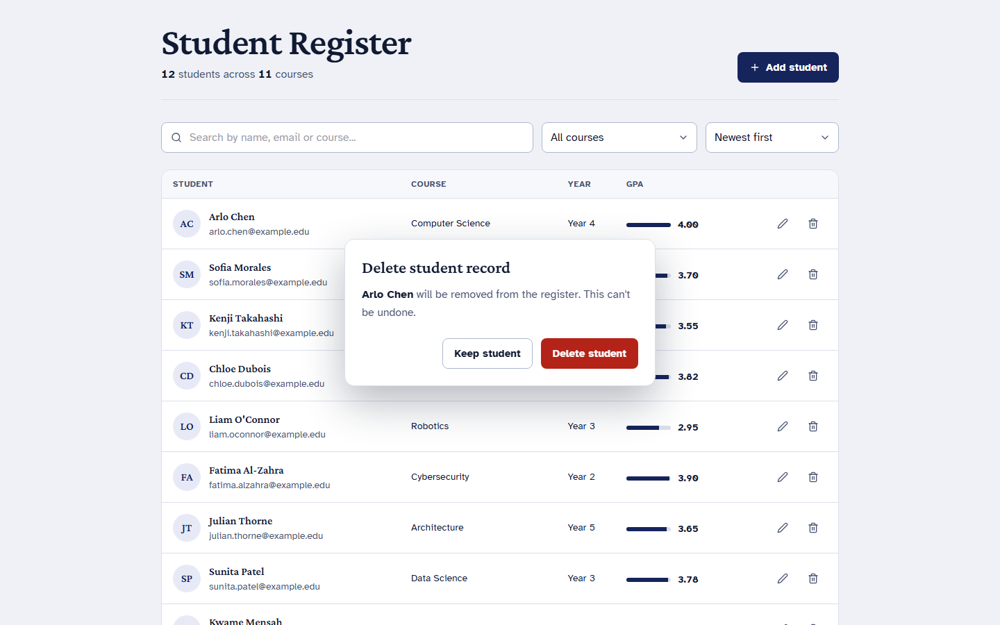 | 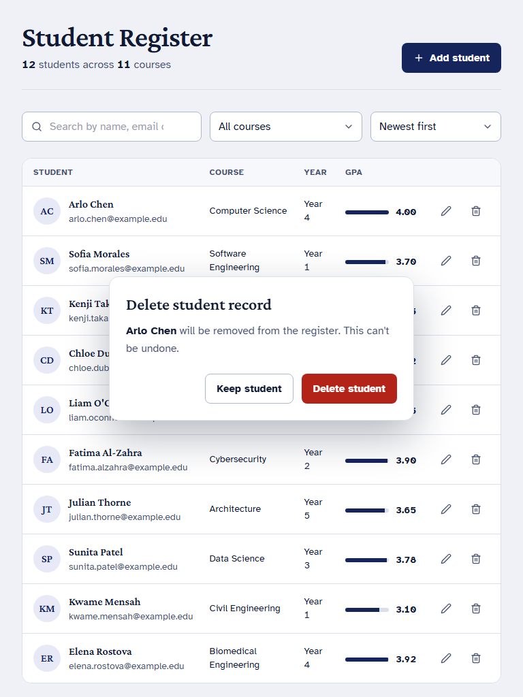 | 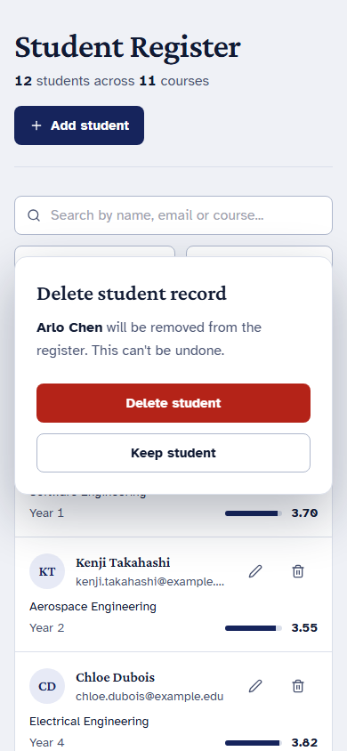 |

---

## Features

- Add, edit and delete students with inline validation (client and server)
- Student details shown as an ID card
- Search by name, email or course, with matches highlighted
- Filter by course, sort by name, course, year or GPA
- Server-side pagination
- Loading, empty and error states on every view
- Responsive from 360px phones to wide desktops, keyboard accessible (WCAG 2.2 AA target)

## Tech stack

| Layer    | Technology                                                                               |
| -------- | ---------------------------------------------------------------------------------------- |
| Frontend | React 18, TypeScript, Vite, Tailwind CSS, Radix UI, TanStack Query, React Hook Form, Zod |
| Backend  | Node.js 20+, Express, TypeScript, Zod, Pino                                              |
| Database | SQLite through Prisma (switch to PostgreSQL by changing one line)                        |
| Testing  | Vitest, Supertest, Testing Library, Playwright                                           |
| Tooling  | ESLint, Prettier, npm workspaces, GitHub Actions                                         |

## Architecture

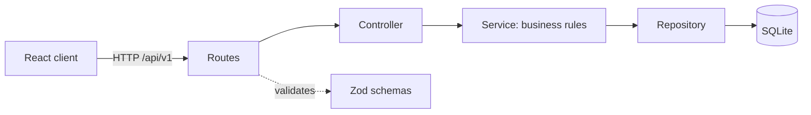

- **Server** is layered: routes, controller, service, repository. Only the repository touches the database. Input is validated once, at the edge, with Zod.
- **Client** is organized by feature. Server state lives in TanStack Query, form state in React Hook Form, and filters in the URL so views are shareable.
- **Design tokens** live in one CSS file and are the only way colors, radii and shadows reach components.

## Getting started

Requirements: Node.js 20 or newer.

```bash
npm install
cp server/.env.example server/.env
npm run db:migrate     # create the database
npm run db:seed        # optional: 12 sample students
npm run dev            # client on :5173, API on :4000
```

## Scripts

| Command                 | What it does                        |
| ----------------------- | ----------------------------------- |
| `npm run dev`           | Start client and API together       |
| `npm run build`         | Production build of both workspaces |
| `npm run lint`          | ESLint, zero warnings allowed       |
| `npm run typecheck`     | `tsc --noEmit` on both workspaces   |
| `npm run format`        | Prettier                            |
| `npm run test`          | Unit and integration tests          |
| `npm run test:coverage` | Tests with coverage report          |
| `npm run test:e2e`      | Playwright end-to-end test          |
| `npm run db:migrate`    | Apply Prisma migrations             |
| `npm run db:seed`       | Insert sample students              |

## Environment variables (`server/.env`)

| Variable       | Default                 | Purpose                  |
| -------------- | ----------------------- | ------------------------ |
| `PORT`         | `4000`                  | API port                 |
| `DATABASE_URL` | `file:./dev.db`         | Prisma connection string |
| `CORS_ORIGIN`  | `http://localhost:5173` | Allowed browser origin   |
| `NODE_ENV`     | `development`           | Runtime mode             |

## API

Base path: `/api/v1`

| Method | Endpoint            | Description                                                                               |
| ------ | ------------------- | ----------------------------------------------------------------------------------------- |
| GET    | `/students`         | List students. Query: `page`, `limit`, `q`, `course`, `sort` (for example `lastName:asc`) |
| GET    | `/students/courses` | Distinct course names                                                                     |
| GET    | `/students/:id`     | One student                                                                               |
| POST   | `/students`         | Create a student                                                                          |
| PATCH  | `/students/:id`     | Update one or more fields                                                                 |
| DELETE | `/students/:id`     | Delete a student                                                                          |
| GET    | `/health`           | Health check                                                                              |

List response:

```json
{ "data": [], "meta": { "page": 1, "limit": 10, "total": 0, "totalPages": 0 } }
```

Error response:

```json
{
  "error": {
    "code": "VALIDATION_ERROR",
    "message": "Check the highlighted fields.",
    "fields": { "email": "Enter a valid email address." }
  }
}
```

Status codes: `200`, `201`, `204`, `400` (validation), `404` (not found), `409` (email already used), `500`.

## Student model

| Field                    | Type     | Rules                              |
| ------------------------ | -------- | ---------------------------------- |
| `id`                     | string   | Generated                          |
| `firstName`, `lastName`  | string   | Required, trimmed                  |
| `email`                  | string   | Required, unique, stored lowercase |
| `phone`                  | string   | Optional                           |
| `course`                 | string   | Required                           |
| `year`                   | integer  | 1 to 6                             |
| `gpa`                    | number   | Optional, 0 to 4, two decimals     |
| `createdAt`, `updatedAt` | datetime | Generated                          |

## Project structure

```
.
├── client/
│   └── src/
│       ├── app/                 providers and root component
│       ├── components/ui/       design-system primitives
│       ├── features/students/   api, components, hooks, schemas
│       ├── lib/                 http client, formatting helpers
│       └── styles/              tokens.css, globals.css
├── server/
│   ├── prisma/                  schema, migrations, seed
│   └── src/
│       ├── config/              validated environment
│       ├── lib/                 logger, prisma client, AppError
│       ├── middleware/          validate, error handler, not found
│       └── modules/students/    routes, controller, service, repository, schemas, tests
├── docs/DESIGN_SYSTEM.md
└── .agents/                     rules, skills and workflows for Antigravity
```

## Testing

- Server services are unit-tested with a fake repository.
- API routes are tested end to end with Supertest against a temporary SQLite database.
- Components are tested with Testing Library by role and accessible name.
- One Playwright test covers add, search, view, edit and delete.

## Design system

Colors, typography, spacing, motion, component states and accessibility rules are documented in [docs/DESIGN_SYSTEM.md](docs/DESIGN_SYSTEM.md). Components consume tokens only.

## Contributing

Use Conventional Commits. Before opening a pull request run `npm run lint && npm run typecheck && npm run test`.
